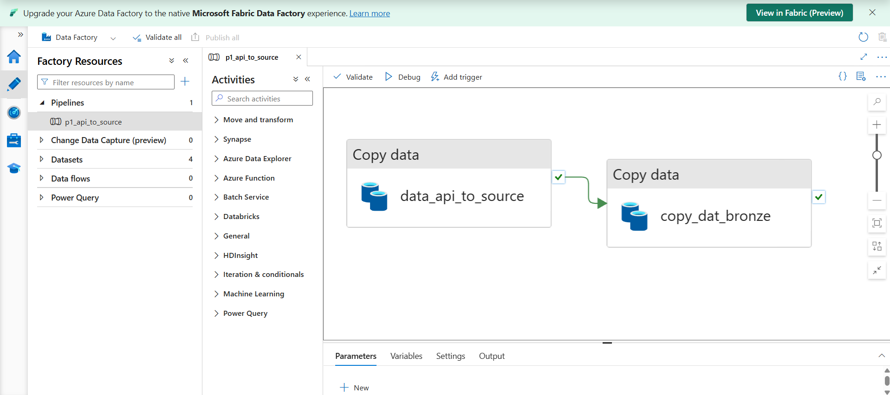
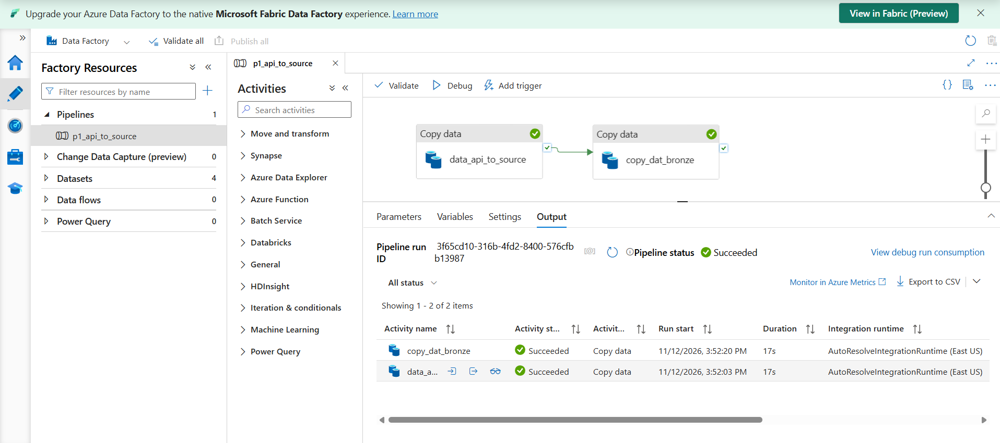
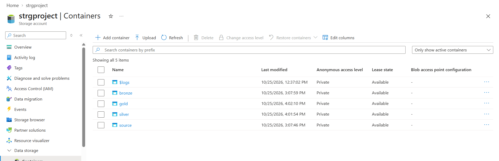
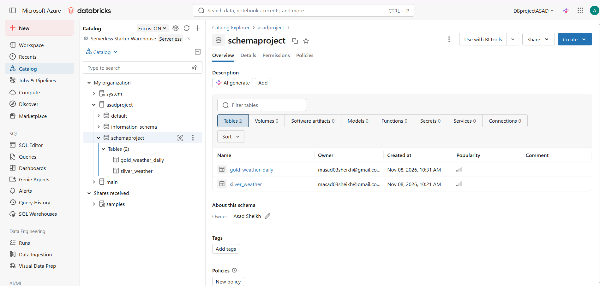
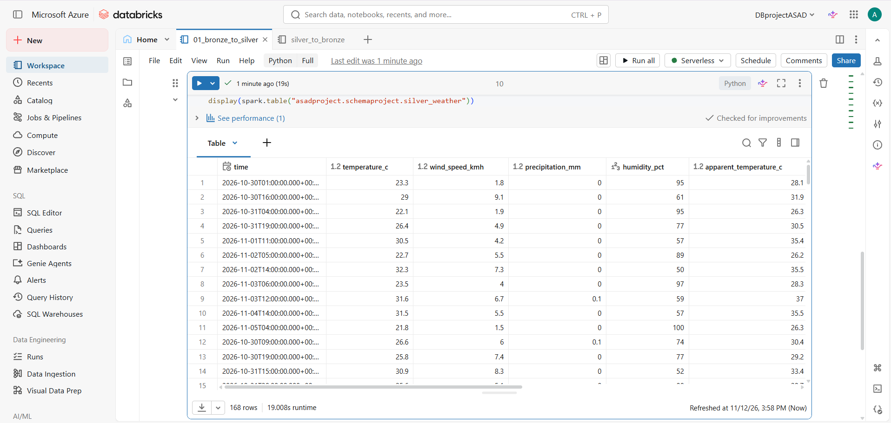
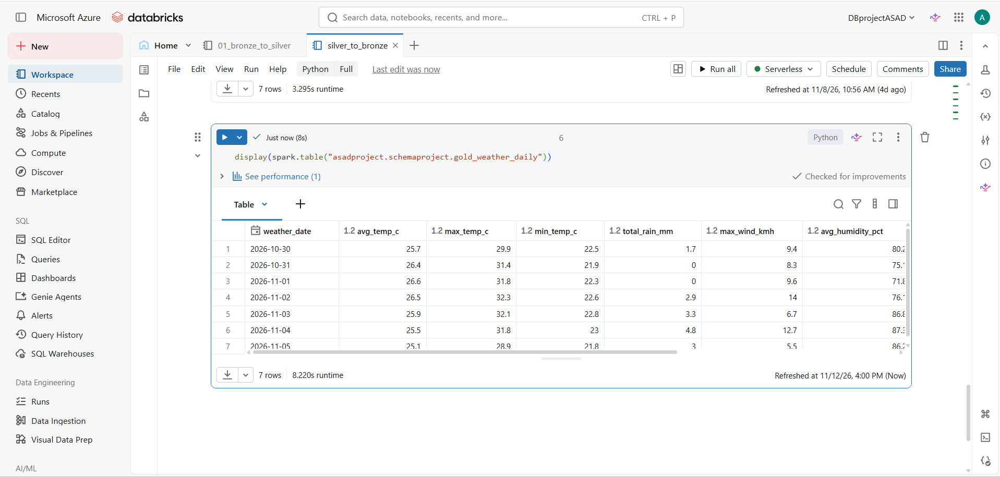

# Weather Risk Lakehouse– Azure Data Factory, ADLS Gen2 & Databricks

_Turning hourly weather API data into clean, queryable Delta tables with daily safety risk flags, using Azure Data Factory, PySpark, and Databricks._

---

##  Table of Contents
- <a href="#overview">Overview</a>
- <a href="#business-problem">Business Problem</a>
- <a href="#dataset">Dataset</a>
- <a href="#tools--technologies">Tools & Technologies</a>
- <a href="#project-structure">Project Structure</a>
- <a href="#data-cleaning--preparation">Data Cleaning & Preparation</a>
- <a href="#gold-layer--risk-flags">Gold Layer & Risk Flags</a>
- <a href="#key-findings">Key Findings</a>
- <a href="#pipeline-screenshots">Pipeline Screenshots</a>
- <a href="#how-to-run-this-project">How to Run This Project</a>
- <a href="#final-recommendations">Final Recommendations</a>
- <a href="#author--contact">Author & Contact</a>

---
<h2><a class="anchor" id="overview"></a>Overview</h2>

This project builds a complete data pipeline on Azure that pulls hourly weather data from a REST API and organises it into bronze, silver and gold layers. Azure Data Factory handles ingestion into ADLS Gen2, PySpark notebooks in Azure Databricks flatten and clean the data into Delta tables, and the final gold table gives one row per day with heat, rain and wind risk flags for site safety planning.

---
<h2><a class="anchor" id="business-problem"></a>Business Problem</h2>

Safety and operations teams on outdoor sites need to know what the weather will be like each day, but raw weather API responses are nested JSON with long lists of values, which cannot be queried or charted directly. This project aims to:
- Ingest hourly weather data from an API automatically through Azure Data Factory
- Convert nested JSON arrays into a clean, one-row-per-hour table
- Validate the data (nulls, impossible values, duplicate hours)
- Summarise the weather per day for planning
- Flag days with heat, rain or wind risk

---
<h2><a class="anchor" id="dataset"></a>Dataset</h2>

- Source: [Open-Meteo](https://open-meteo.com/) weather forecast API (free, no key required)
- Format: JSON, with hourly values stored as parallel lists
- Period: 30 Oct 2026 to 5 Nov 2026 (the current day plus the next 6 days), 168 hourly records
- Location: Chandrapur area, Maharashtra, India (time zone Asia/Kolkata)
- Hourly variables: temperature, apparent temperature, soil temperature, wind speed, precipitation, relative humidity, cloud cover and visibility
- A sample of the raw response is in `data/sample_weather.json`

---

<h2><a class="anchor" id="tools--technologies"></a>Tools & Technologies</h2>

- Azure Data Factory (linked services, datasets, Copy activities, retry settings)
- Azure Data Lake Storage Gen2 (`source`, `bronze`, `silver`, `gold` containers)
- Azure Databricks (Serverless compute)
- PySpark and SQL (flattening, cleaning, aggregation)
- Delta Lake and Unity Catalog (external locations, Delta tables)
- GitHub

---
<h2><a class="anchor" id="project-structure"></a>Project Structure</h2>

```
weather-pipeline-azure/
│
├── README.md
│
├── adf/                        # Exported Azure Data Factory pipeline
│   └── pipeline.json
│
├── data/                       # Sample of the raw API response
│   └── sample_weather.json
│
├── notebooks/                  # Databricks notebooks
│   ├── 01_bronze_to_silver.ipynb
│   └── 02_silver_to_gold.ipynb
│
├── screenshots/                # Pipeline, storage and table screenshots
│   ├── 01_adf_pipeline_png.png
│   ├── 02_adf_run_succeeded_png.png
│   ├── 03_adls_containers_png.png
│   ├── 04_databricks_tables_png.png
│   ├── 05_silver_output_png.png
│   └── 06_gold_output_png.png
```

---
<h2><a class="anchor" id="data-cleaning--preparation"></a>Data Cleaning & Preparation</h2>

**Ingestion (Azure Data Factory)**
- Pipeline `p1_api_to_source` has two Copy activities connected on success
- `data_api_to_source` reads the API response and writes the raw JSON to the `source` container
- `copy_dat_bronze` copies the file from `source` to the `bronze` container
- Both activities use the Binary format, so the raw response is kept exactly as received, with 3 retries 30 seconds apart

**Bronze to Silver (Databricks notebook 1)**
- Read the raw JSON file from the `bronze` container
- Flattened the parallel arrays in the `hourly` field into one row per hour using `arrays_zip` and `explode`
- Converted `time` from text to a timestamp
- Renamed columns so every name shows its unit (for example `temperature_c`, `wind_speed_kmh`, `precipitation_mm`, `humidity_pct`, `visibility_m`)
- Added `weather_date`, `hour_of_day` and `ingestionTime` columns
- Checked every column for null values (none found)
- Filtered out impossible values (humidity or cloud cover outside 0 to 100, negative wind, rainfall or visibility) and dropped duplicate hours
- Saved the result as the Delta table `silver_weather` in the `silver` container

All 168 hourly rows passed the checks, so the silver table holds 168 rows with 12 columns.

---
<h2><a class="anchor" id="gold-layer--risk-flags"></a>Gold Layer & Risk Flags</h2>

The second notebook reads `silver_weather` and builds `gold_weather_daily`, with one row per day:

- `avg_temp_c`, `max_temp_c`, `min_temp_c`
- `total_rain_mm`, `max_wind_kmh`, `avg_humidity_pct`
- `hours_recorded` (24 for a complete day)
- `heat_risk`, `rain_risk`, `wind_risk` (Low, Medium or High)

| Flag                              | Medium            | High            |
|-----------------------------------|-------------------|-----------------|
| `heat_risk` (maximum temperature) | 35 °C or more     | 40 °C or more   |
| `rain_risk` (daily rainfall)      | 2 mm or more      | 10 mm or more   |
| `wind_risk` (maximum wind speed)  | 25 km/h or more   | 40 km/h or more |

These limits are example values and can be replaced with the limits your site or company uses.

---
<h2><a class="anchor" id="key-findings"></a>Key Findings</h2>

| Date       | Avg Temp (°C) | Max Temp (°C) | Min Temp (°C) | Rain (mm) | Max Wind (km/h) | Avg Humidity (%) | Heat | Rain   | Wind |
|------------|---------------|---------------|---------------|-----------|-----------------|------------------|------|--------|------|
| 2026-10-30 | 25.7          | 29.9          | 22.5          | 1.7       | 9.4             | 80.2             | Low  | Low    | Low  |
| 2026-10-31 | 26.4          | 31.4          | 21.9          | 0.0       | 8.3             | 75.1             | Low  | Low    | Low  |
| 2026-11-01 | 26.6          | 31.8          | 22.3          | 0.0       | 9.6             | 71.8             | Low  | Low    | Low  |
| 2026-11-02 | 26.5          | 32.3          | 22.6          | 2.9       | 14.0            | 76.1             | Low  | Medium | Low  |
| 2026-11-03 | 25.9          | 32.1          | 22.8          | 3.3       | 6.7             | 86.8             | Low  | Medium | Low  |
| 2026-11-04 | 25.5          | 31.8          | 23.0          | 4.8       | 12.7            | 87.3             | Low  | Medium | Low  |
| 2026-11-05 | 25.1          | 28.9          | 21.8          | 3.0       | 5.5             | 86.2             | Low  | Medium | Low  |

1. **Heat**: Temperatures stayed between 21.8 °C and 32.3 °C, with the hottest day on 2 Nov, so no day reached the 35 °C Medium heat threshold.
2. **Rain**: About 15.7 mm of rain fell over the week. Four days (2 to 5 Nov) crossed the 2 mm Medium threshold, and the wettest day was 4 Nov with 4.8 mm.
3. **Wind**: The strongest wind was 14 km/h on 2 Nov, well below the 25 km/h Medium threshold.
4. **Humidity**: Average humidity rose to 86 to 87% on 3 to 5 Nov, the same days with the highest rainfall.
5. **Data completeness**: Every day has 24 hourly records, with no null values in any column.

---
<h2><a class="anchor" id="pipeline-screenshots"></a>Pipeline Screenshots</h2>

**Azure Data Factory pipeline**



**Pipeline run: both Copy activities succeeded**



**ADLS Gen2 containers**



**Databricks tables in Unity Catalog**



**Silver table output (hourly)**



**Gold table output (daily)**



---
<h2><a class="anchor" id="how-to-run-this-project"></a>How to Run This Project</h2>

1. Clone the repository:
```bash
git clone https://github.com/yourusername/weather-pipeline-azure.git
```
2. Create an ADLS Gen2 storage account (hierarchical namespace enabled) with four containers: `source`, `bronze`, `silver` and `gold`.
3. In Azure Data Factory, create a linked service for the API (HTTP, base URL `https://api.open-meteo.com`) and one for your storage account. Create the datasets and the pipeline `p1_api_to_source` using `adf/pipeline.json` as the reference.
4. Run the pipeline and confirm the weather file appears in the `source` and `bronze` containers.
5. In Databricks, create Unity Catalog external locations for the `bronze`, `silver` and `gold` containers.
6. Open and run the notebooks in order, replacing the storage account name and the catalog and schema names with your own:
   - `notebooks/01_bronze_to_silver.ipynb`
   - `notebooks/02_silver_to_gold.ipynb`
7. Query the result:
```sql
SELECT * FROM asadproject.schemaproject.gold_weather_daily;
```

---
<h2><a class="anchor" id="final-recommendations"></a>Final Recommendations</h2>

- Use the rain flag to plan rain-sensitive outdoor work on Low days and prepare cover on Medium days
- Check the heat flag each morning during hot months, and adjust work hours when it reaches Medium or High
- Review the wind flag before lifting or work at height
- Replace the example thresholds with the site's own safety limits
- Join the gold table with incident or inspection data to study how weather affects safety

---
<h2><a class="anchor" id="author--contact"></a>Author & Contact</h2>

**Asad Sheikh**   
📧 Email: masad03sheikh@gmail.com  
🔗 LinkedIn: www.linkedin.com/in/madasad-sheikh 
